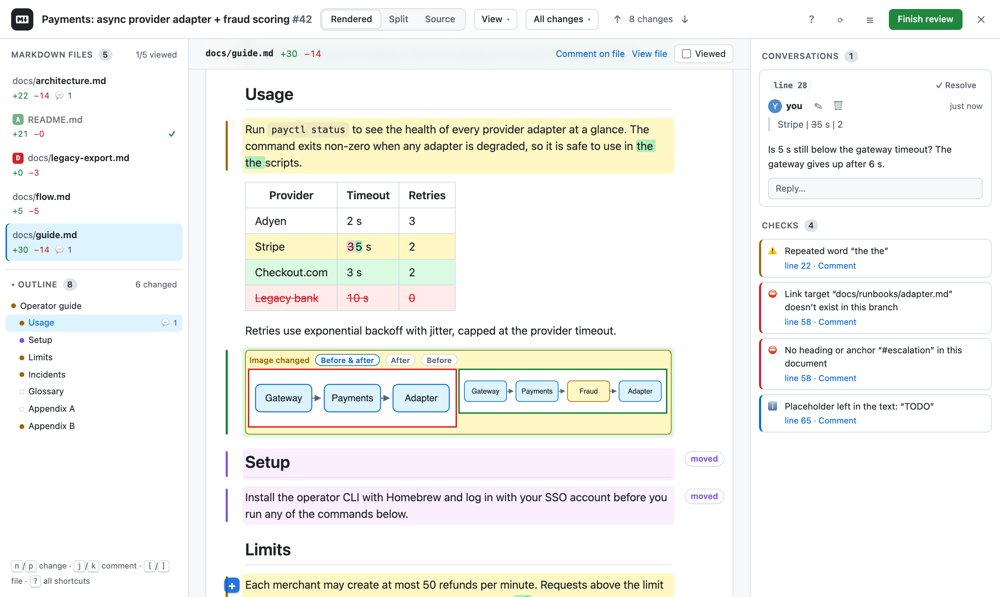
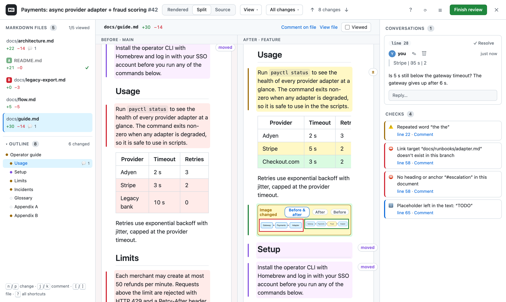

<h1 align="center">Markdown PR Review</h1>

<p align="center">
  Review the Markdown in a GitHub pull request the way you read a document, not a diff.<br>
  A Chrome extension for <b>github.com</b>, <b>GitHub Enterprise Server</b> and <b>GHE.com</b>.
</p>

<p align="center">
  <a href="#license"></a>
  
  
</p>

<p align="center">
  
</p>

Open a pull request, press **Review Markdown**, and a full-page **overlay** shows every `.md` file of the PR as a rendered page with GitHub's own styling. Changed paragraphs are highlighted, a **Word diff** shows exactly which words changed, and you comment by selecting text – the extension works out the source lines for you and posts a normal GitHub review comment.

It is built around what makes reviewing prose in pull requests painful: GitHub's rich diff can't be commented on, a one-word edit marks a whole soft-wrapped paragraph as changed, re-wrapping a paragraph or re-padding a table drowns the real edits, moved sections show up as a big delete plus a big add, tables, images and math are unreadable as source, and there is no easy way to see only what changed since your last review.

## Contents

- [Features](#features)
- [Install](#install)
- [Setup](#setup)
- [Keyboard shortcuts](#keyboard-shortcuts)
- [How comments are placed](#how-comments-are-placed)
- [How it works](#how-it-works)
- [Development](#development)
- [Privacy](#privacy)
- [Limitations](#limitations)
- [License](#license)

## Features

### Read

- **Rendered view** of every `.md`, `.markdown`, `.mdown`, `.mkd` and `.mdx` file in the PR, in GitHub's light or dark Markdown styling (it follows your GitHub theme). Tables, task lists, footnotes, emoji shortcodes (`:rocket:`), strikethrough and GitHub alerts (`> [!NOTE]`, `> [!WARNING]`, …) render like on GitHub; YAML (and Hugo's TOML) front matter is shown as a code block at the top instead of being dropped.
- **HTML in Markdown** renders the way GitHub renders it – `<details>`, `<p align="center">`, ``, `<picture>` with dark/light sources, `<kbd>`, `<sup>`, … – through GitHub's own sanitizing rules, so scripts, styles and event handlers never run. Images marked `#gh-dark-mode-only` / `#gh-light-mode-only` follow the theme.
- **Math**: `$…$`, `` $`…`$ ``, `$$…$$` and ```` ```math ```` blocks, like GitHub. Dollar amounts ("between $5 and $10") stay text. KaTeX (~260 KB, rendering MathML) loads only for documents with math.
- **Mermaid diagrams** (```` ```mermaid ```` blocks) are rendered as diagrams. The Mermaid library (~5 MB) is loaded only when a document actually contains one.
- **Docs-site admonitions** – Docusaurus `:::note` / `:::warning[Title]` and MkDocs `!!! tip "Title"` – render as callouts instead of plain text (*View → Docs-site admonitions*). In `.mdx` files the `import` / `export` lines are shown as code.
- **Working links.** `#anchor` links (also to footnotes and `<a name>` anchors) scroll inside the overlay, links to another Markdown file of the same PR open that file in the overlay (Ctrl/⌘-click opens GitHub instead), and relative links and images resolve to the PR's head commit.
- **Outline** of the open document in the left column: every heading, a dot for sections the PR added (green), changed (amber) or moved (purple), comment counts per section, and the section you are reading highlighted.
- **Split view** shows the old and the new version rendered side by side; scrolling one keeps the other at the same place of the document (matched through the diff, not by percentage). **Source mode** shows the raw Markdown with line numbers and the diff. Both are just as commentable.

<p align="center">
  
</p>

### See what changed

- **Changes in the rendered document.** Added blocks are green, modified blocks amber, and deleted passages appear as collapsible red *Removed N lines* blocks. `n` / `p` jump between changes.
- **Word diff.** Inside a changed paragraph, list item, heading or code block the exact words that changed are marked, while the rest of the block keeps its formatting – code spans, emphasis, links, inline HTML and formulas survive. A change that spans several list items or paragraphs stays split into those items. Chinese and Japanese are split into words (not whole sentences). A paragraph rewritten from scratch is shown as removed + added instead of a word soup.
- **Re-wrapped text is not a change.** A paragraph whose line breaks moved, or a table whose columns were re-padded, reads the same – with *View → Hide whitespace-only changes* (on by default) it gets only a faint dotted marker instead of a highlight. Paragraph splits, hard line breaks, list nesting and anything in code still count.
- **Moved sections.** Text removed in one place and added unchanged in another is shown as **moved** (purple) at its new place, with a small *moved to line N* marker where it used to be – even when git paired the old text with whatever was written in its place.
- **Tables, cell by cell.** An edited row shows a word diff in each cell; a deleted row stays in its table, struck out; new rows are green.
- **Images.** When the PR changes an image file a document shows, it is marked *Image changed* with **Before & after** side by side (or either one); new image files are marked *New image*. A replaced image reference in the text is shown as the old image (red) and the new one (green).
- **Formulas and diagrams.** A changed formula shows its old version struck through above the new one. When a Mermaid diagram changed, its **Changes** view shows what changed inside the diagram:
  - a **flowchart** becomes one merged diagram – added nodes and edges green, removed ones red and dashed, relabelled nodes amber;
  - every other diagram type (sequence, class, state, ER, gantt, pie, …) is shown **Before / After** side by side, with the labels that exist on one side only highlighted.

  **After**, **Before** and **Source** switch to the single versions and to the code block.

- **Changes since your last review.** The header's **All changes ▾** menu shows the changes since *your last review* or since any commit of the PR, instead of everything the PR changes; files without new changes are dimmed in the file list. After a force-push the changes are computed file by file.
- **Changes only.** *View → Changes only* (`f`) folds the unchanged parts of a long document into *⋯ N unchanged blocks* placeholders; headings stay as signposts.
- **Deleted, new and renamed files.** A file the PR deletes is still shown – its last version from the base commit – under a *deleted* banner (comments go on its removed lines). A brand-new file gets a *New file* banner and no change highlighting (everything would be green, so `n` / `p` have nothing to jump to). Renamed files show *old → new* in the file bar, and the file list marks files **A** / **D** / **R**. Files too large for GitHub to diff get their changes computed locally (the extension gives up after two seconds on two very different long files and says so, rather than freezing the tab).

### Review

- **Comment on any selected text.** Select a phrase and press **Comment** (or `c`). The selection is mapped to the exact source line(s), even inside long, soft-wrapped paragraphs, and quoted in the comment. Deleted words of a word diff stay ~~struck through~~ in the quote.
- **Comment on a whole block.** Hover a paragraph, table row, image, diagram or code block and click the **+** on its left.
- **Comment on removed text.** Selecting text in a *Removed* block, a struck-out table row, deleted words of the word diff, a deleted source line or the left side of the split view posts a comment on the **left side of the diff** (the old line), like GitHub's *Files changed* does.
- **Suggest a change.** **Suggest** (or `s`) pre-fills a ```` ```suggestion ```` block with the source lines and selects the words you had selected, so typing replaces them. **Preview** shows the comment as GitHub will render it, with the suggestion as a diff.
- **Draft reviews.** Collect comments across files, edit or delete them in the side panel, then **Finish review** as *Comment*, *Approve* or *Request changes*; the dialog lists every draft by file (click one to go to it) and warns about a pending review started in GitHub's own UI. Drafts are kept per pull request and survive page reloads and browser restarts until you submit or delete them. **Comment now** posts a single comment immediately. **Comment on file** in the file bar comments on the file as a whole.
- **Conversations** show up as badges next to the block they refer to and in the side panel, where you can reply, **resolve / unresolve** them, and **edit or delete** your own comments. Suggestions in comments are shown as a diff of what they would change. `j` / `k` jump between conversations. Resolved and outdated conversations are tucked away in their own sections.
- **Checks.** The side panel lists what a docs reviewer would otherwise catch by eye, on the lines the PR changed: links to files that don't exist in the branch, `#anchors` that match no heading (also in other files of the PR), images without alt text, heading levels that skip, repeated words (“the the”), Markdown that didn't render (a broken link, unpaired `**`), HTML that GitHub strips (`<center>`, `style=""`), and leftover `TODO` / `FIXME`. Broken links are underlined in the document; **Comment** turns a finding into a comment.
- **Viewed** state stays in sync with GitHub's *Viewed* checkbox (`v`), and marking a file viewed moves on to the next unviewed one. With many files, filter the list (`/`) or hide viewed files.
- **Stays current.** While the review is open, new comments by others appear by themselves, and a banner says when new commits were pushed (⟳ reloads them; your drafts are kept, and drafts written against the older commit are flagged so you can check their lines).

### Header

The header holds the **Rendered / Split / Source** switch, the **View** menu (*Word diff*, *Hide whitespace-only changes*, *Changes only*, *Docs-site admonitions*), the **All changes / Since …** menu, a change counter with **↑ / ↓** (it turns into *3 / 10* as you step through the changes with `n` / `p`), **?** for the keyboard shortcuts, **⟳** to reload the pull request after it received new commits (your drafts and the open file are kept) and **☰** to hide or show the side panel. The display mode and the View options are remembered per GitHub host; the file you were reading – and where you were in each file – are remembered for as long as the tab is open.

## Install

The extension is built from source and loaded unpacked. You need **Node.js 18 or newer** (with npm) and **Chrome 110 or newer**:

```bash
npm install
npm run build          # builds dist/
```

1. Open `chrome://extensions` and enable **Developer mode**.
2. Click **Load unpacked** and select the `dist/` folder.
3. Open the extension's **Options** (right-click the toolbar icon → *Options*) and add a token (optional for reading public repositories on github.com, see [Setup](#setup)).
4. Open a pull request. Once its file list has loaded, a **Review Markdown** button with the number of Markdown files appears bottom-right; the toolbar icon and `Alt`+`Shift`+`M` open and close the same review.

On a pull request without Markdown files the button is not shown, and the toolbar icon or shortcut only show a note saying so. If the extension can't reach the API, the button's icon turns amber (hover it for the error): **Connect a token to review Markdown** means no token is saved for this instance and opens Options; **Markdown review unavailable – retry** reloads the pull request data.

## Setup

### Token

The extension calls the GitHub REST and GraphQL APIs with a **classic** personal access token, one per GitHub instance. On github.com the token is optional for *reading* pull requests in public repositories – GitHub's unauthenticated limit of 60 requests per hour applies, and the launcher turns into *Connect a token* once it is hit. Commenting, replying, resolving conversations and the *Viewed* state always need one. To create a token:

1. In Options, click **Generate a classic token** next to the instance. It opens `https://<instance>/settings/tokens/new?scopes=repo` with the scope preselected. (Manually: *Settings → Developer settings → Personal access tokens → Tokens (classic)*.)
2. Select **only the `repo` scope**. It covers reading pull requests and files, posting comments and reviews, resolving conversations and the *Viewed* state. For public repositories only, `public_repo` is enough. No other scopes are needed.
3. If your organization uses SAML single sign-on, click **Configure SSO → Authorize** for that organization, or its repositories stay invisible to the token.
4. Paste the token into Options and click **Save**. You should see *Connected as @login*.

Fine-grained tokens (`github_pat_…`) are not supported: organizations often restrict them, and comments then fail with *Resource not accessible by personal access token*.

### GitHub Enterprise

In Options → **GitHub Enterprise**, enter the instance URL, e.g. `https://github.acme.corp`. Chrome asks for permission to run on that host (the extension declares it as an *optional* host permission and requests it only then). The API URL is derived automatically and can be overridden:

| Instance | API URL |
|---|---|
| GitHub Enterprise Server | `https://HOST/api/v3` (GraphQL: `https://HOST/api/graphql`) |
| GHE.com (`*.ghe.com`) | `https://api.SUBDOMAIN.ghe.com` |

After an instance is added, the background worker registers the content script for it; reload tabs of that instance that were already open. Clicking the toolbar icon on an instance that isn't configured yet opens Options with its URL prefilled.

## Keyboard shortcuts

| Key | Action |
|---|---|
| `Alt` + `Shift` + `M` | Open or close the overlay (works anywhere on a PR page) |
| `n` / `p` | Next / previous change |
| `j` / `k` | Next / previous conversation |
| `[` / `]` | Previous / next file |
| `v` | Toggle *Viewed* for the current file |
| `c` / `s` | Comment on / suggest a change to the selected text |
| `w` | Word diff on / off |
| `f` | *Changes only* on / off |
| `1` / `2` / `3` | Rendered / Split / Source |
| `/` | Filter the file list |
| `?` | Show all shortcuts |
| `Ctrl` + `Enter` (⌘ on Mac) | Add the comment to the review, send a reply, submit the review dialog |
| `Ctrl` + `Shift` + `Enter` | Post the comment immediately |
| `Esc` | Close the menu or dialog, then the overlay. In a half-written comment it asks for a second `Esc` before discarding it |

Only `Alt` + `Shift` + `M` is a Chrome command and can be rebound at `chrome://extensions/shortcuts`; the other keys are fixed and work only while the review is open.

## How comments are placed

GitHub only accepts line comments on lines inside a diff hunk, and a multi-line comment must stay inside one hunk. The extension picks the best valid anchor for your selection:

| Your selection | What gets posted |
|---|---|
| Inside the changed part of the file | A line comment on exactly those lines (trimmed to the hunk if it spilled over) |
| Removed text (a *Removed* block or row, deleted words, the left side of split view) | A line comment on the **left side** of the diff – the line of the old version |
| Outside every hunk, or the file has no diff | A **file-level comment** with the quote and line numbers in its body |
| In a file deleted by the PR | A left-side line comment on its removed lines |

The composer tells you which of these applies before you post. Comments always anchor to GitHub's own diff of the pull request, also while *Since …* shows a narrower set of changes (comments on removed text then aren't available, as the old lines on screen aren't the PR's base). On old GitHub Enterprise servers without file-level comments, the file comment becomes a regular PR conversation comment.

## How it works

The content script that runs on GitHub pages is tiny (~12 KB): it recognizes pull request pages (SPA-aware), shows the launcher and loads the review UI – React, the Markdown pipeline, everything else – as a separate module only when you open a review. The review mounts inside a Shadow DOM, isolated from GitHub's CSS. All API calls go through the background service worker, which holds the tokens.

```
src/
  background/index.ts         service worker: API proxy (tokens live here; conditional requests for polling),
                              pagination, dynamic content scripts for Enterprise hosts, toolbar button and shortcut
  content/
    index.ts                  content script: PR detection, the launcher, loads review.js on demand
    launcher.css              theme tokens, launcher and toasts (always loaded)
    api.ts                    GitHub client (REST + GraphQL via the background worker): comments (both sides of
                              the diff) with the file-comment → conversation-comment fallback, reviews, replies,
                              edits, viewed, resolve, commits, compare, tree; and the draft store
    types.ts                  PR / file / comment / draft types, isMarkdown()
    styles.css                the overlay (loaded with review.js)
    components/
      Review.tsx              the overlay: modes, change plan (PR / since a commit / computed), selection → anchor,
                              block comments, navigation, polling, review flow, shortcuts
      MarkdownDoc.tsx         react-markdown renderer; every block gets its source line range, change markers,
                              comment badges, word diff, table cell diffs, moved / removed blocks, math, images
      SplitView.tsx           before | after with diff-aware synchronized scrolling
      FileNav.tsx             file list (filter, viewed) and outline
      Menus.tsx               View and compare menus, keyboard help
      MermaidBlock.tsx        diagram block with the Changes / After / Before / Source views
      SourceDoc.tsx           source mode
      Composer.tsx            the comment / suggestion composer (write / preview)
      Threads.tsx             conversations, drafts and checks in the side panel
      SubmitReview.tsx        the "Finish review" dialog
      WordDiff.tsx            plain word diff, used for code blocks and the ± "what changed" popover
      ErrorBoundary.tsx       keeps a document that fails to render from taking down the review
    lib/
      patch.ts                unified diff → added lines, removals (with base line numbers), hunks on both sides;
                              re-wrap detection, moved-text detection, locally computed diffs, the base version
      annotate.ts             rehype plugin: tags blocks with line ranges, marks changed / moved / commented blocks,
                              pairs table rows
      fold.ts                 rehype plugin: "changes only" folding
      anchor.ts               selection → source lines (both sides); lines → a valid GitHub comment anchor
      inlineDiff.ts           word diff of a block's Markdown source, rendered as Markdown
      tables.ts               table rows and cells, row pairing
      gfm.ts                  GitHub alerts and callouts, the sanitize schema, heading ids (GitHub slugs), anchors
      admonitions.ts          Docusaurus / MkDocs admonitions, MDX import / export lines
      math.ts                 GitHub's math syntax rules, KaTeX loaded on demand
      checks.ts               the review checks
      outline.ts              headings and what changed in each section
      quote.ts                selection → quoted text (keeps deletions struck through, formulas as TeX)
      mermaid.ts              loads dist/mermaid.js on demand, parses and renders diagrams
      mermaidDiff.ts          merges two flowcharts and works out what to colour
  review/entry.tsx            built into dist/review.js (ES module), import()ed when a review opens
  mermaid/entry.ts            built into dist/mermaid.js, import()ed when a document has a diagram
  math/entry.ts               built into dist/katex.js, import()ed when a document has math
  options/                    the settings page
  shared/                     host configuration and message types
```

Rendering uses `react-markdown` with `remark-gfm`, `remark-frontmatter`, `remark-math` and `remark-gemoji`; raw HTML goes through `rehype-raw` and `rehype-sanitize` with GitHub's allow-list (classes are never allowed, so HTML in a document can't pose as part of the review UI). Mermaid diagrams are rendered with `securityLevel: 'strict'`, KaTeX with `trust: false`. Draft comments are kept in `chrome.storage.local`, keyed by pull request.

## Development

```bash
npm run dev          # rebuild dist/ on change
npm test             # unit tests: diff parsing, re-wrap and moved-text detection, line mapping (both sides),
                     # annotation, word diff, tables, rendering (HTML, callouts, math, folding), checks, outline
npm run typecheck
npm run zip          # npm run build + pack dist/ into markdown-pr-review.zip
```

Chrome doesn't pick up a new build by itself: click the reload icon on the extension's card in `chrome://extensions`, then reload the GitHub tabs that were already open. A tab still running the old content script fails its API calls with *The extension was updated. Reload this page to continue.*

A UI playground runs the real review UI against a mocked GitHub API, with fixtures for a modified, an added and a deleted file, Mermaid diagrams, and a docs-site guide (`dev/fixtures/guide-*.md`) that exercises raw HTML, admonitions, math, a moved section, a re-wrapped paragraph, table and image changes and the checks:

```bash
npm run harness && python3 -m http.server 8765
# → http://localhost:8765/dev/harness.html   (add #dark for dark mode)

# Automated UI test against the harness (Playwright). On macOS point it at Chrome:
CHROMIUM="/Applications/Google Chrome.app/Contents/MacOS/Google Chrome" node dev/e2e.mjs
# node dev/e2e.mjs [screenshotDir]   # screenshots go to dev/out by default
# HARNESS_URL=http://localhost:8767 node dev/e2e.mjs   # harness served on another port (default 8765)
```

The real extension can be tested end to end against a fake GitHub Enterprise server (host configuration, dynamic content script, API through the service worker):

```bash
npm run build
node dev/mock-ghe.mjs &
CHROMIUM="<path to Chrome for Testing>" node dev/ext-e2e.mjs
```

Branded Google Chrome no longer accepts `--load-extension`; use Chrome for Testing (Playwright installs one under `~/Library/Caches/ms-playwright/chromium-*/`).

The screenshots in this README are rendered from the harness, so they stay in step with the UI:

```bash
CHROMIUM="/Applications/Google Chrome.app/Contents/MacOS/Google Chrome" node dev/readme-shots.mjs   # → docs/review.png, docs/split.png
```

## Privacy

- Tokens are stored only in the browser's extension storage (`chrome.storage.local`). Only the background service worker reads them, and it sends each token only to the API URL of its own GitHub instance. They are never exposed to the GitHub page.
- The extension talks to nothing but the GitHub instances you configure. There is no telemetry. While a review is open it checks the pull request for new commits and comments once a minute (conditional requests, which don't count against GitHub's rate limit when nothing changed).
- Images in the documents are loaded the way the page loads them: from the repository on GitHub, and external image URLs directly (GitHub's own page proxies those through its image cache).
- It runs on `github.com` out of the box; access to an Enterprise host is requested only when you add it in Options.

## Limitations

- Draft comments live in the extension, not as a GitHub *pending review*. Line comments are submitted together as one review; file-level drafts (see [How comments are placed](#how-comments-are-placed)) can't be part of a review, so they are posted one by one as separate comments right after it. This is also why *Request changes* needs a summary or at least one line comment, while *Approve* can be sent on its own. If you have a pending review started in GitHub's own UI, submit or discard it there first (the *Finish review* dialog tells you).
- Text that was moved **and** edited is shown as removed + added (with the word diff where git paired it), not as moved.
- The checks are deliberately conservative heuristics, not a spell checker or a style linter; links to other repositories and external URLs aren't checked, and in very large repositories (GitHub truncates the file tree) links to files aren't checked either.
- Math is rendered by KaTeX, GitHub uses MathJax: exotic macros can render differently. Docs-site support covers admonitions; other site-specific syntax (MDX components, Hugo shortcodes, …) renders as text.
- The merged **Changes** diagram is built for flowcharts; other Mermaid diagram types fall back to the Before / After view.

## License

[MIT](LICENSE) © 2026 Marcin Borkowski
